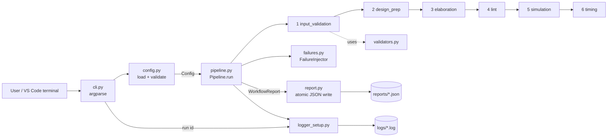

# EDA Workflow Automation Simulator (Python)

A beginner-friendly mini project that shows **how an EDA (Electronic Design Automation) flow is automated with Python**: validate inputs, check configuration, run design-preparation and verification stages in order, simulate failures, retry, log everything with timestamps, and write JSON reports.

> **This is an educational simulation.** It is **not** a real EDA, synthesis, simulation or semiconductor design tool. Every "tool" stage is a small deterministic Python check on Verilog-looking text. Nothing here is from, or endorsed by, Arm or any EDA vendor.

* Python 3.9+ (tested on 3.13), **standard library only** - no `pip install` needed.
* Windows 11 + VS Code friendly. Free tools only.
* **96 unit tests** (`unittest`).

---

## 1. Folder structure

```text
eda_workflow_simulator/
├── README.md                  <- you are here
├── requirements.txt           <- empty on purpose (standard library only)
├── setup.bat                  <- optional: create .venv (Windows)
├── run_demo.bat               <- runs passing + failing demos (Windows)
├── run_tests.bat              <- runs all unit tests (Windows)
├── .gitignore
├── .vscode/                   <- VS Code test + debug settings
├── config/
│   ├── default_config.json    <- same values as the built-in defaults
│   ├── strict_config.json     <- tighter limits (coverage 95%, 2 lint warnings)
│   └── bad_config.json        <- deliberately invalid (for demos/tests)
├── sample_inputs/             <- tiny teaching "designs"
│   ├── counter.v  alu.v                    (pass)
│   ├── broken_unbalanced.v                 (design_prep fails)
│   ├── broken_missing_module.v             (elaboration fails)
│   ├── messy_style.v                       (lint fails)
│   ├── sim_failure.v                       (simulation fails)
│   └── empty.v  wrong_extension.txt        (input_validation fails)
├── eda_sim/                   <- the program
│   ├── __init__.py  __main__.py
│   ├── constants.py           stage order, status names, exit codes
│   ├── exceptions.py          custom error types
│   ├── config.py              load + validate config (dataclasses)
│   ├── validators.py          input-file checks
│   ├── models.py              StageResult, WorkflowReport
│   ├── stages.py              the 6 simulated stages
│   ├── failures.py            failure injector (error / timeout / crash)
│   ├── pipeline.py            runs stages, retry, timestamps
│   ├── logger_setup.py        console + file logging
│   ├── report.py              atomic JSON write, read, summary table
│   └── cli.py                 argparse command line
├── tests/                     <- 96 unittest tests
├── docs/                      <- architecture, troubleshooting, interview Q&A, ...
├── reports/                   <- JSON reports appear here
└── logs/                      <- log files appear here
```

## 2. Architecture



More detail: [docs/ARCHITECTURE.md](docs/ARCHITECTURE.md).

## 3. Windows 11 setup (one time)

Open **PowerShell** (Start menu -> "PowerShell").

```powershell
# 1. Install free tools (skip any you already have)
winget install --id Python.Python.3.12 -e
winget install --id Microsoft.VisualStudioCode -e
winget install --id Git.Git -e
```

Close and reopen PowerShell, then check:

```powershell
py -3 --version
git --version
```

Install the **Python** extension in VS Code (Extensions icon -> search "Python" -> Microsoft). No winget? Download Python from <https://www.python.org/downloads/> and **tick "Add python.exe to PATH"**.

Unzip the project, then:

```powershell
cd C:\path\to\eda_workflow_simulator
code .                      # opens VS Code in this folder
```

Optional virtual environment (the project has no dependencies, so this is just good practice):

```powershell
py -3 -m venv .venv
.venv\Scripts\Activate.ps1
```

If PowerShell says *"running scripts is disabled"*, run once: `Set-ExecutionPolicy -Scope CurrentUser RemoteSigned`, or use Command Prompt and `.venv\Scripts\activate.bat`.

In VS Code press `Ctrl+Shift+P` -> **Python: Select Interpreter** -> choose `.venv` (or your Python 3).

## 4. Run it

Run these from the project folder (the one containing `eda_sim`). After activating `.venv`, use `python`; otherwise use `py -3`.

```powershell
# Easiest: double-click or run the demo script
.\run_demo.bat

# Or one command at a time
py -3 -m eda_sim list-stages
py -3 -m eda_sim run sample_inputs\counter.v
py -3 -m eda_sim run sample_inputs\alu.v
py -3 -m eda_sim run sample_inputs\broken_unbalanced.v
py -3 -m eda_sim run sample_inputs\counter.v --inject-failure simulation --failure-mode timeout
py -3 -m eda_sim run sample_inputs\counter.v --inject-failure lint --failure-mode crash
py -3 -m eda_sim run sample_inputs\counter.v --target-mhz 5000
py -3 -m eda_sim run sample_inputs\counter.v --config config\strict_config.json
py -3 -m eda_sim validate-config config\bad_config.json
py -3 -m eda_sim validate-input sample_inputs\wrong_extension.txt
py -3 -m eda_sim show-report reports\<one report file>.json
```

Reports go to `reports\`, logs to `logs\`.

## 5. Run the tests

```powershell
.\run_tests.bat
# or
py -3 -m unittest discover -s tests -t . -v
```

In VS Code: Testing icon (flask) -> the tests are discovered automatically (`.vscode/settings.json`).

## 6. Command reference

| Command | What it does | Exit code |
|---|---|---|
| `run DESIGN [flags]` | Runs the workflow, writes report + log | 0 pass, 1 workflow failed, 2 bad config/usage |
| `validate-config FILE` | Checks a config file | 0 ok, 2 invalid |
| `validate-input FILE [--config F]` | Checks only the design file | 0 ok, 1 invalid |
| `list-stages` | Lists stages | 0 |
| `show-report FILE` | Prints a table from a JSON report | 0, or 2 if unreadable |

`run` flags: `--config`, `--report-dir`, `--log-dir`, `--log-level {DEBUG,INFO,WARNING,ERROR}`, `--delay-ms`, `--target-mhz`, `--inject-failure STAGE`, `--failure-mode {error,timeout,crash}`, `--fail-attempts N`, `--quiet`. Flags override the config file; the result is validated again.

## 7. Config reference (`config/default_config.json`)

| Key | Meaning |
|---|---|
| `project_name` | Free text label |
| `input.allowed_extensions` | Accepted file extensions (start with `.`) |
| `input.max_file_size_kb` | Size limit |
| `output.report_dir` / `output.log_dir` | Where outputs go |
| `logging.level` | DEBUG, INFO, WARNING, ERROR |
| `stages` | Subset of the 6 stages, in canonical order |
| `retry.max_attempts` | Attempts per stage (only timeouts are retried) |
| `simulated_delay_ms` | Fake work time per stage attempt |
| `lint.max_warnings` / `lint.max_line_length` | Lint limits |
| `simulation.seed` / `tests_per_module` / `min_coverage_percent` | Simulation settings |
| `timing.target_clock_mhz` / `min_slack_ns` | Timing goal |
| `failure_simulation.enabled/stage/mode/fail_attempts` | Failure injection |

Unknown keys, wrong types and out-of-range values are rejected with a clear message (try `config\bad_config.json`).

## 8. How the stages work

| # | Stage | What it really checks | Typical failure |
|---|---|---|---|
| 1 | `input_validation` | exists, extension, non-empty, size, no NUL bytes, UTF-8 | `Input file is empty` |
| 2 | `design_prep` | strips comments, finds `module`s, `module`/`endmodule` balance, counts `assign`/`always` | `Unbalanced design` |
| 3 | `elaboration` | every instantiated module is defined in the file | `Unresolved module reference(s)` |
| 4 | `lint` | tabs, trailing spaces, long lines, TODO/FIXME vs `max_warnings` | `6 lint warning(s) exceed limit` |
| 5 | `simulation` | fake tests; `// SIM_FAIL` forces a fail; seeded "coverage" vs minimum | `1 of 5 simulated test(s) failed` |
| 6 | `timing` | invented critical path vs clock period -> slack | `Timing violated` |

Stages run in order; the first failure stops the run and later stages are marked `SKIPPED`. The numbers in `simulation` and `timing` are **invented but deterministic** (same file + same seed = same result).

## 9. Failure simulation

| Mode | Behaviour | Shows |
|---|---|---|
| `error` | raises a normal `StageError` | expected failure handling |
| `timeout` | fails the first `fail_attempts` attempts, then works | **retry** logic |
| `crash` | raises an unexpected `RuntimeError` | last-resort `except Exception` + traceback in the log |

## 10. Sample output

Real output captured by actually running the commands is in [docs/SAMPLE_OUTPUT.md](docs/SAMPLE_OUTPUT.md), and a real JSON report is in [docs/sample_report.json](docs/sample_report.json). Short excerpt (a deliberate failure; timestamps/IDs differ on every run):

```text
> python -m eda_sim run sample_inputs/broken_unbalanced.v --delay-ms 0 --quiet

Status   : FAILED
Stage             Status   Tries         ms  Detail
----------------------------------------------------------------------
input_validation  PASSED   1            0.3  broken_unbalanced.v accepted
design_prep       FAILED   1            0.1  Unbalanced design: 1 'module' vs 0 'endmodule'
elaboration       SKIPPED  0            0.0  Skipped: earlier stage failed
lint              SKIPPED  0            0.0  Skipped: earlier stage failed
simulation        SKIPPED  0            0.0  Skipped: earlier stage failed
timing            SKIPPED  0            0.0  Skipped: earlier stage failed
----------------------------------------------------------------------
passed=1 failed=1 skipped=4 total=6
```

## 11. Debugging in VS Code

Open `.vscode/launch.json` configurations via **Run and Debug** (`Ctrl+Shift+D`): "Run counter.v", "Run broken_unbalanced.v", "Run tests". Click left of a line number to set a breakpoint (for example in `eda_sim/pipeline.py` `_run_stage`), then press `F5`.

## 12. Troubleshooting

See [docs/TROUBLESHOOTING.md](docs/TROUBLESHOOTING.md).

## 13. Upload to GitHub

See [docs/GITHUB_UPLOAD.md](docs/GITHUB_UPLOAD.md).

## 14. Interview preparation

* [docs/INTERVIEW_QUESTIONS.md](docs/INTERVIEW_QUESTIONS.md) - 20 Arm-focused questions with answers
* [docs/RESUME_BULLETS.md](docs/RESUME_BULLETS.md) - honest resume bullets and a 60-second pitch

## 15. Honest limitations

* Not real EDA: no real Verilog parser, synthesis, simulator or timing engine.
* Instantiation detection is a simple regex (no `generate`, no multi-line headers).
* Developed and tested on Linux with Python 3.13 (96 tests pass). The Windows `.bat` files and PowerShell commands follow standard Windows behaviour, but were written without running them on a Windows machine. Everything in `eda_sim/` uses `pathlib`, so paths work on Windows.

## 16. Ideas to extend it (good interview talking points)

Run several designs in parallel with `concurrent.futures`; add an HTML report; add a `--fail-fast off` mode; add pytest or GitHub Actions CI; add a `regression` command that runs every file in a folder and prints a pass-rate table.
