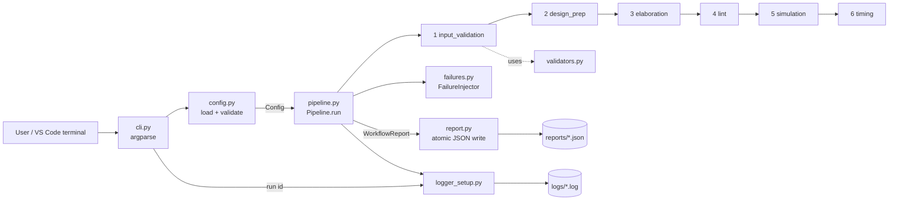
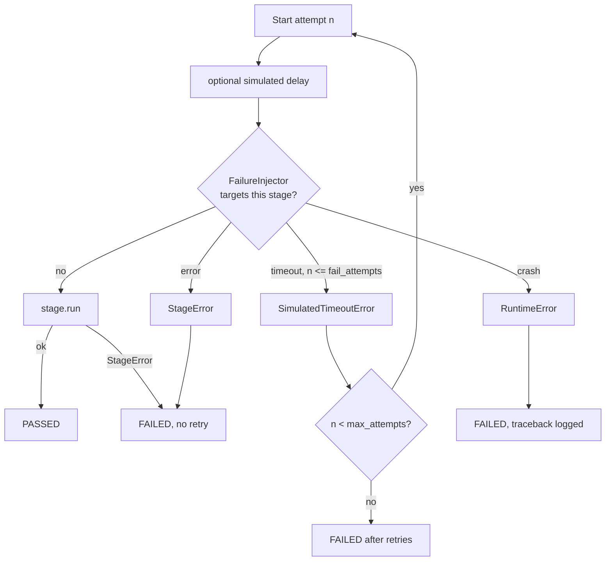

# Architecture

## Component diagram

## Stage attempt flow (retry logic)

## Data flow

1. `cli.py` parses arguments, loads the config (`config.py`), applies flag overrides and re-validates.
2. A **run id** (UTC time with milliseconds, e.g. `20261018T071851686Z`) names the log and report files so runs never overwrite each other.
3. `Pipeline.run` creates a `StageContext` (config, design path, shared `state` dict). Stages communicate only through `state` (e.g. `design_prep` stores `modules`, `elaboration` reads it). A stage that needs missing state fails with a clear "must run first" error.
4. Each stage returns `StageOutput(messages, metrics)` or raises. The pipeline turns that into a `StageResult` with start/end timestamps, duration and attempts.
5. The first non-passing stage stops the run; remaining stages are `SKIPPED`.
6. `report.write_report` writes JSON to a temp file in the same folder, then `os.replace` moves it into place (atomic).

## Design decisions

| Decision | Why |
|---|---|
| Custom exception hierarchy | Separates expected failures (`StageError`) from bugs (anything else) |
| Frozen dataclasses for config | Immutable, typed, validated once at the edge |
| Reject unknown config keys | A typo should be an error, not silently ignored |
| Injectable clock and sleep | Fast, deterministic tests with no real waiting |
| Seeded RNG from seed + file CRC | Reproducible "tool results" like a real regression |
| Atomic report writes | No half-written JSON if the process dies |
| Run id with milliseconds | Two runs in the same second must not collide (found and fixed while capturing sample output) |
| Exit codes 0/1/2 | CI systems and scripts can react to the result |
